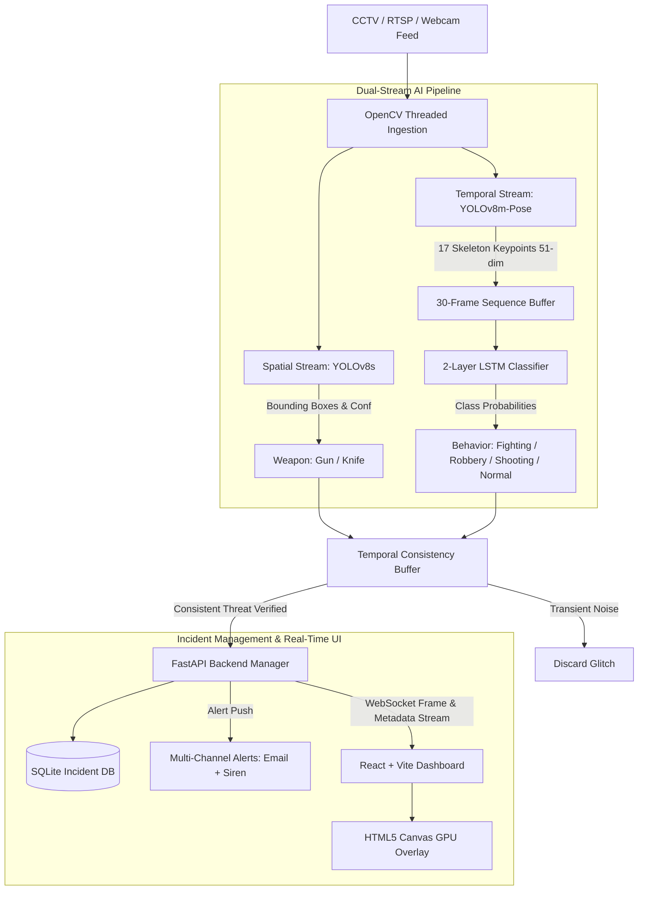

# 🛡️ SENTINEL
### Real-Time AI-Powered Surveillance System for Weapon Detection and Behavioral Crime Recognition

[](https://www.python.org/)
[](https://pytorch.org/)
[](https://github.com/ultralytics/ultralytics)
[](https://fastapi.tiangolo.com/)
[](https://vitejs.dev/)
[-orange.svg)]()

---

## 📌 Executive Summary

**SENTINEL** is an intelligent, real-time edge surveillance system engineered to overcome human cognitive fatigue in CCTV monitoring. While human operators miss up to 90% of suspicious activities after 20 minutes of continuous monitoring, SENTINEL operates continuously at **≥25 FPS** on consumer-grade edge GPUs, autonomously detecting lethal weapons and classifying violent physical interactions.

Unlike traditional systems that rely on slow, compute-heavy 3D-CNNs or single-frame weapon detectors that cause false alarms, SENTINEL introduces a **Dual-Stream Architecture** combining:
1. **Spatial Stream (Weapon Detection)**: Fine-tuned **YOLOv8s** for rapid identification of guns and knives.
2. **Temporal Stream (Behavioral Crime Recognition)**: **YOLOv8m-Pose** skeleton extraction (17 COCO keypoints) coupled with a **2-Layer LSTM** network operating across 30-frame temporal windows.
3. **Temporal Consistency Buffer**: A lightweight sliding-window IoU verification filter that eliminates false alarm flicker without compute overhead.

---

## 🏗️ System Architecture



---

## 🎯 Target Threat Classes

| Module | Classes | Description |
|---|---|---|
| **Weapon Detection (Spatial)** | **Gun** | Handguns, Pistols, Revolvers, Rifles, Shotguns |
| | **Knife** | Daggers, Hunting Knives, Kitchen Blades, Machetes |
| **Behavior Recognition (Temporal)** | **Normal Activity** | Walking, standing, benign everyday interactions |
| | **Fighting** | Physical assault, punching, kicking, wrestling, brawling |
| | **Robbery** | Sudden physical intimidation, snatching, mugging dynamic |
| | **Shooting** | Firearm aiming posture, shooting stance, recoil dynamic |

---

## 📁 Repository Organization

```
FYP/
├── .gitignore                      # Git ignore rules for datasets, weights & caches
├── README.md                       # Main repository overview (this file)
├── PROJECT_CONTEXT.md              # Master project context & finalized decision log
├── AGENTS.md                       # Directives for AI coding assistants
│
├── docs/                           # Comprehensive technical documentation
│   ├── architecture_deep_dive.md   # In-depth component analysis (Input -> Process -> Output)
│   ├── project_decisions.md        # Technical trade-off matrix & choices
│   ├── roadmap_wbs.md              # 10-Month milestone schedule & dates
│   ├── capability_matrix.md        # Literature review comparison against state-of-the-art
│   └── team_responsibilities.md    # Work Breakdown Structure (WBS) & member tasks
│
├── DataSets/                       # Dataset directories (tracked via .gitkeep)
│   ├── README.md                   # Instructions for downloading Kaggle, UCF-Crime & RWF-2000
│   ├── raw/                        # Untouched raw media
│   └── curated/                    # Unified YOLO annotations & LSTM pose sequences
│
├── models/                         # Model definitions & weight storage
│   ├── README.md                   # Pre-trained checkpoint information
│   └── weights/                    # Saved .pt / .onnx weight binaries (gitignored)
│
├── scripts/                        # Automation & processing scripts
│   ├── data_preparation/          # Scripts for dataset merging, filtering & keypoint extraction
│   ├── training/                   # Model fine-tuning & training routines
│   └── inference/                  # FPS benchmarks & standalone test runners
│
├── src/                            # Core production codebase
│   ├── backend/                    # FastAPI server, WebSockets, SQLite ORM
│   ├── frontend/                   # React + Vite surveillance dashboard
│   └── pipeline/                   # OpenCV capture, AI models, Temporal Buffer
│
└── Literature Review/              # Academic deliverables
    ├── Documentation/              # Approved FYP-I proposal, thesis chapters, defense slides
    └── Research_Papers/            # 5 Key IEEE/Springer reference papers
```

---

## 🚀 Quickstart & Setup Guide

### 1. Clone the Repository
```bash
git clone https://github.com/muddassir1935/FYP.git
cd FYP
```

### 2. Python Environment Setup
```bash
python -m venv venv
# Windows:
.\venv\Scripts\activate
# Linux/macOS:
source venv/bin/activate

pip install --upgrade pip
# Install core dependencies (PyTorch, Ultralytics, FastAPI, OpenCV)
pip install torch torchvision --index-url https://download.pytorch.org/whl/cu121
pip install ultralytics fastapi uvicorn[standard] opencv-python sqlalchemy websockets
```

### 3. Frontend Setup
```bash
cd src/frontend
npm install
npm run dev
```

---

## 👥 FYP Team

* **Muddassir Rizwan** — *ML/AI Model Development (Lead)*  
  Fine-tuning YOLOv8s, YOLOv8m-Pose extraction, 2-Layer LSTM modeling, hyperparameter optimization.
* **Faiz Hussain** — *Backend & Systems Pipeline*  
  OpenCV RTSP video ingestion, Temporal Consistency Buffer, FastAPI backend, WebSockets.
* **Qaim Mehdi** — *Frontend Dashboard & UI*  
  React + Vite dashboard, HTML5 Canvas GPU rendering, alert audio sirens, incident logging UI.

---

## 📄 License & Academic Usage

This project is developed as an academic Final Year Project (FYP). All rights reserved by the project team.
