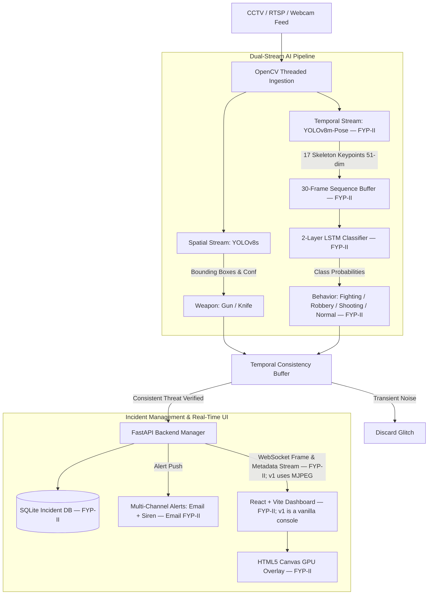

# 🛡️ SENTINEL
### Real-Time AI-Powered Surveillance System for Weapon Detection and Behavioral Crime Recognition

[](https://www.python.org/)
[](https://pytorch.org/)
[](https://github.com/ultralytics/ultralytics)
[](https://fastapi.tiangolo.com/)
[](https://vitejs.dev/)
[-orange.svg)]()

---

## 📌 Executive Summary

**SENTINEL** is an intelligent, real-time edge surveillance system engineered to overcome human cognitive fatigue in CCTV monitoring. Human monitoring accuracy drops sharply over a shift [citation needed], and SENTINEL is built to watch without tiring. **As of FYP-I (Nov 2026), the weapon-detection stream is live**: the YOLOv8s detector runs at **≥25 FPS** on the demo laptop (Intel Iris Xe via OpenVINO — 39 FPS inference, ~30 FPS end-to-end), autonomously detecting guns and knives. The behavior stream (pose + LSTM classification of violent interactions) is dataset-ready — 3,579 pose sequences — but the model itself is FYP-II work, as are email alerts and the React dashboard.

Unlike traditional systems that rely on slow, compute-heavy 3D-CNNs or single-frame weapon detectors that cause false alarms, SENTINEL introduces a **Dual-Stream Architecture** combining:
1. **Spatial Stream (Weapon Detection)**: Fine-tuned **YOLOv8s** for rapid identification of guns and knives.
2. **Temporal Stream (Behavioral Crime Recognition)**: **YOLOv8m-Pose** skeleton extraction (17 COCO keypoints) coupled with a **2-Layer LSTM** network operating across 30-frame temporal windows.
3. **Temporal Consistency Buffer**: A lightweight sliding-window IoU verification filter that eliminates false alarm flicker without compute overhead.

---

## 🏗️ System Architecture — TARGET (proposal design, not all built yet)

> This is the **target architecture** from the approved proposal. Components
> marked **[FYP-II]** are not built yet; the FYP-I demo is the weapon stream
> + temporal buffer + a vanilla single-page console (see
> `docs/demo_ui_plan.md`, shipped as PR #35).



---

## 🎯 Target Threat Classes

| Module | Classes | Description |
|---|---|---|
| **Weapon Detection (Spatial)** | **Gun** | Handguns, Pistols, Revolvers, Rifles, Shotguns |
| | **Knife** | Daggers, Hunting Knives, Kitchen Blades, Machetes |
| **Behavior Recognition (Temporal)** | **Normal Activity** | Walking, standing, benign everyday interactions |
| | **Fighting** | Physical assault, punching, kicking, wrestling, brawling |
| | **Robbery** | Sudden physical intimidation, snatching, mugging dynamic |
| | **Shooting** | Firearm aiming posture, shooting stance, recoil dynamic |

---

## 📁 Repository Organization

```
FYP/
├── .gitignore                      # Git ignore rules for datasets, weights & caches
├── README.md                       # Main repository overview (this file)
├── PROJECT_CONTEXT.md              # Master project context & finalized decision log
├── AGENTS.md                       # Directives for AI coding assistants
│
├── docs/                           # Comprehensive technical documentation
│   ├── git_and_engineering_workflow.md # Git branching, commit format & integration rules
│   ├── architecture_deep_dive.md   # In-depth component analysis (Input -> Process -> Output)
│   ├── project_decisions.md        # Technical trade-off matrix & choices
│   ├── roadmap_wbs.md              # 10-Month milestone schedule & dates
│   ├── capability_matrix.md        # Literature review comparison against state-of-the-art
│   ├── team_responsibilities.md    # Work Breakdown Structure (WBS) & member tasks
│   ├── training_run_log.md         # Every training run: config, metrics, weights hashes
│   ├── dataset_summary.md          # Dataset versions, splits & the leakage record
│   ├── engineering_logbook.md      # Dated engineering decisions & dataset evolution
│   ├── demo_ui_plan.md             # Demo web UI plan, API & verification (shipped PR #35)
│   ├── pipeline_weapon_demo.md     # Weapon pipeline, OpenVINO & demo tuning knobs
│   └── rq3_temporal_buffer.md      # RQ3: temporal-buffer FP-suppression measurement
│
├── DataSets/                       # Dataset directories (tracked via .gitkeep)
│   ├── README.md                   # Instructions for downloading Kaggle, UCF-Crime & RWF-2000
│   ├── raw/                        # Untouched raw media
│   └── curated/                    # Unified YOLO annotations & LSTM pose sequences
│
├── models/                         # Model definitions & weight storage
│   ├── README.md                   # Pre-trained checkpoint information
│   └── weights/                    # Saved .pt / .onnx weight binaries (gitignored)
│
├── scripts/                        # Automation & processing scripts
│   ├── data_preparation/          # Scripts for dataset merging, filtering & keypoint extraction
│   ├── training/                   # Model fine-tuning & training routines
│   └── inference/                  # FPS benchmarks & standalone test runners
│
├── src/                            # Core production codebase
│   ├── backend/                    # FastAPI server, WebSockets, SQLite ORM
│   ├── frontend/                   # React + Vite surveillance dashboard
│   └── pipeline/                   # OpenCV capture, AI models, Temporal Buffer
│
└── Literature Review/              # Academic deliverables
    ├── Documentation/              # Approved FYP-I proposal, thesis chapters, defense slides
    └── Research_Papers/            # 5 Key IEEE/Springer reference papers
```

---

## 🌿 Engineering Workflow & Contribution Standards

To maintain production stability, all team members and AI assistants follow these strict rules (detailed in [docs/git_and_engineering_workflow.md](./docs/git_and_engineering_workflow.md)):

1. **Never Commit Directly to `main`**:
   * Create a feature branch before writing code: `git checkout -b feature/<name>`.
2. **Human-Grade Conventional Commits (No AI Fluff)**:
   * Format: `<type>(<scope>): <summary in imperative mood, max 72 chars>`.
   * Example: `feat(data): add negative background sample generator for weapon dataset`.
3. **Verify Locally**:
   * Run standalone scripts and test frame rates before merging into `main`.

---

## 🚀 Quickstart & Setup Guide

### 1. Clone the Repository
```bash
git clone https://github.com/muddassir1935/FYP.git
cd FYP
```

### 2. Python Environment Setup
```bash
python -m venv venv
# Windows:
.\venv\Scripts\activate
# Linux/macOS:
source venv/bin/activate

pip install --upgrade pip
pip install torch torchvision --index-url https://download.pytorch.org/whl/cu121
pip install ultralytics fastapi uvicorn[standard] opencv-python sqlalchemy websockets
```

### 3. Frontend Setup
```bash
cd src/frontend
npm install
npm run dev
```

---

## 🖥️ Demo Web UI (FYP-I)

No terminal flags needed — pick a video or webcam, pick weights, press
Start. One command from the repo root:

```bash
pip install -r requirements.txt
python scripts/run_demo_ui.py
```

Then open http://127.0.0.1:8000 (the browser opens automatically).
Put clips in `videos/` and weights (`.pt` or an `*_openvino_model`
folder) in `models/weights/` first — or upload a clip from the UI.
To stop the server, use the Stop server button at the bottom of the
control panel (closing the tab does not stop the process), or Ctrl+C
in the terminal.

The UI is a single vanilla page (no build step, no webfonts): live
annotated stream with fullscreen, pause/resume controls, FPS + detection
stats, a confirmed-threat alert banner with an optional siren, uploaded-
clip management (upload & delete), and a snapshot gallery.
Plan, API, and design: `docs/demo_ui_plan.md`. The CLI demo still
works unchanged: `python scripts/inference/run_weapon_demo.py --help`.

---

## 👥 FYP Team

* **Muddassir Rizwan** (`23K-0784`) — *ML/AI Model Development (Lead)*  
  Fine-tuning YOLOv8s, YOLOv8m-Pose extraction, 2-Layer LSTM modeling, hyperparameter optimization.
* **Faiz Hussain** (`23K-2061`) — *Backend & Systems Pipeline*  
  OpenCV RTSP video ingestion, Temporal Consistency Buffer, FastAPI backend, WebSockets.
* **Qaim Mehdi** (`23K-2075`) — *Frontend Dashboard & UI*  
  React + Vite dashboard, HTML5 Canvas GPU rendering, alert audio sirens, incident logging UI.

---

## 📄 License & Intellectual Property

This project is developed as an academic Final Year Project (FYP) at **FAST-NUCES Karachi Campus**.

* **Copyright (c) 2026 Muddassir Rizwan, Faiz Hussain, Qaim Mehdi.** The source code and documentation in this repository are released under the [MIT License](LICENSE).
* **Trained model weights and datasets are not part of this repository.** They are kept private and are excluded from version control (see `.gitignore`). The code is open; the trained models and curated data are not.
* **Third-party software** used by this project (YOLOv8, PyTorch, OpenCV, OpenVINO, NumPy) is listed with its licence in [THIRD-PARTY-LICENSES.md](THIRD-PARTY-LICENSES.md).
