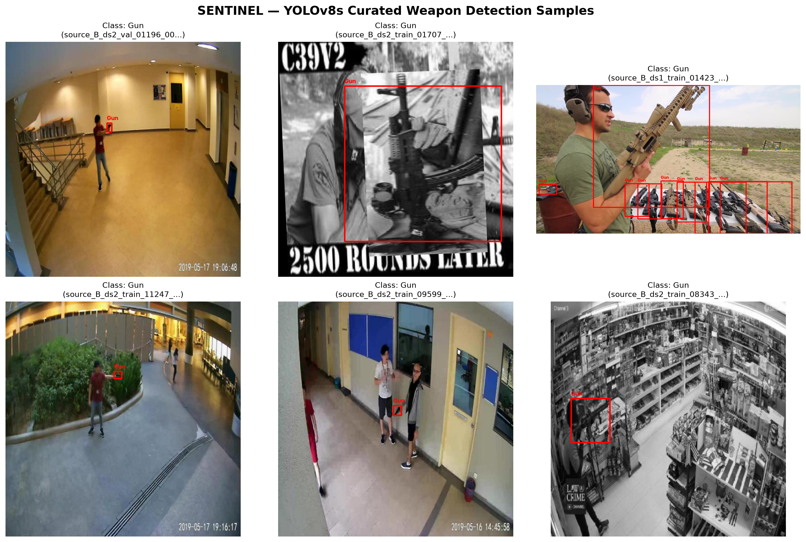
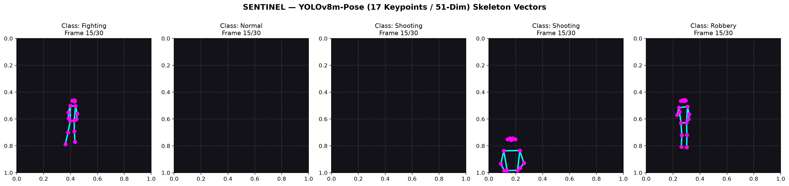

# 📊 SENTINEL — Curated Dataset Preprocessing & Verification Report

> **Generated Automatically**: 2026-10-11 18:43:19  
> **Status**: Verified & Synchronized with FYP-I Master Proposal

---

## 1. 🗡️ Weapon Detection Dataset Summary (YOLOv8s)

* **Schema**: 2-Class Architecture (`0: Gun`, `1: Knife`)
* **Format**: Ultralytics YOLO (`<class_id> <x_center> <y_center> <width> <height>`)
* **Total Images Processed**: **5,363**
* **Negative Background Samples**: **804** (15.0% ratio for false-alarm suppression)
* **Configuration File**: [`DataSets/curated/weapon_yolo/dataset.yaml`](../DataSets/curated/weapon_yolo/dataset.yaml)

### Split & Class Distribution

| Split | Gun (0) | Knife (1) | Background (Negative) | Split Total | Percentage |
|:---|:---:|:---:|:---:|:---:|:---:|
| **Train (70%)** | 3,078 | 112 | 562 | **3,752** | 70.0% |
| **Val (20%)** | 879 | 32 | 160 | **1,071** | 20.0% |
| **Test (10%)** | 441 | 17 | 82 | **540** | 10.1% |
| **Total** | **4,398** | **161** | **804** | **5,363** | **100.0%** |

---

## 2. 🥋 Behavior & Action Recognition Dataset Summary (YOLOv8m-Pose + 2-Layer LSTM)

* **Architecture**: 17 Keypoints × 3 = **51 dimensions** per frame
* **Window Size**: **30 consecutive frames** (Sliding Window, shape: `(30, 51)`)
* **Classes**: 4 Canonical Crime Categories
  * `0: Normal Activity` (RWF-2000 NonFight)
  * `1: Fighting` (RWF-2000 Fight + UCF-Crime Fighting)
  * `2: Robbery` (UCF-Crime Robbery)
  * `3: Shooting` (UCF-Crime Shooting)
* **Anti-Data-Leakage**: Partitioned at video level **prior** to temporal window extraction.
* **Integrity Audit**: **0** NaN/Inf array corruption incidents.
* **Total `(30, 51)` Sequences Extracted**: **128**

### Split & Sequence Distribution

| Split | Normal (0) | Fighting (1) | Robbery (2) | Shooting (3) | Total Sequences |
|:---|:---:|:---:|:---:|:---:|:---:|
| **Train (70%)** | 16 | 16 | 28 | 28 | **88** |
| **Val (20%)** | 4 | 4 | 7 | 7 | **22** |
| **Test (10%)** | 4 | 4 | 7 | 3 | **18** |
| **Total** | **24** | **24** | **42** | **38** | **128** |

---

## 3. 🛡️ Quality Assurance & Engineering Integrity

* [x] **Path Independence**: All preprocessing scripts use dynamic `pathlib.Path` resolution.
* [x] **Zero Data Leakage**: Video streams partitioned strictly prior to sequence windowing.
* [x] **Coordinate Normalization**: All bounding boxes clamped to `[0.0, 1.0]`; degenerate boxes discarded.
* [x] **Corrupted File Quarantine**: Quarantined items tracked in [`DataSets/raw/quarantine_log.txt`](../DataSets/raw/quarantine_log.txt).
* [x] **Git Cleanliness**: Raw datasets, videos, images, and `.npy` binaries are ignored in [`.gitignore`](../.gitignore).
