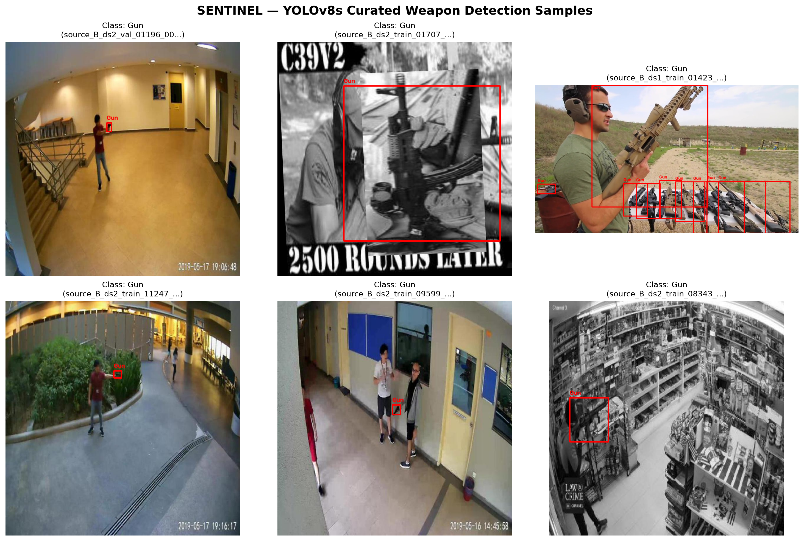
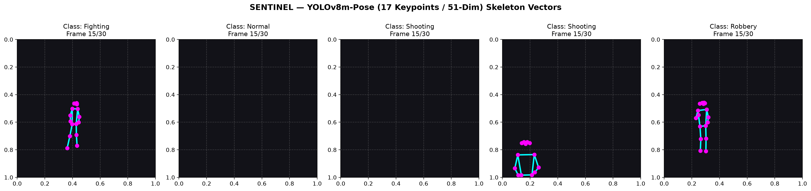

# 📊 SENTINEL — Curated Dataset Preprocessing & Verification Report

> **Generated Automatically**: 2026-10-17 16:09:30  
> **Status**: Verified & Synchronized with FYP-I Master Proposal  
> **Update (2026-11-23):** §1 describes the v1 weapon dataset only. The
> weapon dataset has since gone through v2, v2.1, v3 and v4 — see the new
> §4. The "Zero Data Leakage" checkbox in §3 is scoped to the **behavior**
> dataset only (see the weapon-dataset leakage note below).

---

## 1. 🗡️ Weapon Detection Dataset Summary (YOLOv8s)

* **Schema**: 2-Class Architecture (`0: Gun`, `1: Knife`)
* **Format**: Ultralytics YOLO (`<class_id> <x_center> <y_center> <width> <height>`)
* **Total Images Processed**: **6,762**
* **Negative Background Samples**: **1,014** (15.0% ratio for false-alarm suppression)
* **Configuration File**: [`DataSets/curated/weapon_yolo/dataset.yaml`](../DataSets/curated/weapon_yolo/dataset.yaml)

### Split & Class Distribution

| Split | Gun (0) | Knife (1) | Background (Negative) | Split Total | Percentage |
|:---|:---:|:---:|:---:|:---:|:---:|
| **Train (70%)** | 3,078 | 944 | 709 | **4,731** | 70.0% |
| **Val (20%)** | 879 | 270 | 202 | **1,351** | 20.0% |
| **Test (10%)** | 441 | 136 | 103 | **680** | 10.1% |
| **Total** | **4,398** | **1,350** | **1,014** | **6,762** | **100.0%** |

---

## 2. 🥋 Behavior & Action Recognition Dataset Summary (YOLOv8m-Pose + 2-Layer LSTM)

* **Architecture**: 17 Keypoints × 3 = **51 dimensions** per frame
* **Window Size**: **30 consecutive frames** (Sliding Window, shape: `(30, 51)`)
* **Classes**: 4 Canonical Crime Categories
  * `0: Normal Activity` (RWF-2000 NonFight)
  * `1: Fighting` (RWF-2000 Fight + UCF-Crime Fighting)
  * `2: Robbery` (UCF-Crime Robbery)
  * `3: Shooting` (UCF-Crime Shooting)
* **Anti-Data-Leakage**: Partitioned at video level **prior** to temporal window extraction.
* **Integrity Audit**: **0** NaN/Inf array corruption incidents.
* **Total `(30, 51)` Sequences Extracted**: **3,579**

### Split & Sequence Distribution

| Split | Normal (0) | Fighting (1) | Robbery (2) | Shooting (3) | Total Sequences |
|:---|:---:|:---:|:---:|:---:|:---:|
| **Train (70%)** | 490 | 490 | 759 | 738 | **2,477** |
| **Val (20%)** | 140 | 174 | 228 | 228 | **770** |
| **Test (10%)** | 70 | 70 | 114 | 78 | **332** |
| **Total** | **700** | **734** | **1,101** | **1,044** | **3,579** |

---

## 3. 🛡️ Quality Assurance & Engineering Integrity

* [x] **Path Independence**: All preprocessing scripts use dynamic `pathlib.Path` resolution.
* [x] **Zero Data Leakage — BEHAVIOR dataset only**: Video streams
  partitioned strictly prior to sequence windowing (§2). This checkbox
  does **not** cover the weapon dataset — see the leakage note below.
* [ ] **Weapon dataset leakage (found by the Stage-1 audit, 21 Nov 2026):**
  the weapon split was random by frame, and `source_B` video frames were
  split across train/test. **169/680 test images (25%)** have a verified
  near-duplicate in train, including **18 byte-identical** train/test
  pairs; **303/1,351 val images (22%)** leak into train the same way.
  All frozen-test mAP50 numbers (v1–v4) are therefore leakage-inflated;
  the cleaned-511 test is a Stage-1-cleaned number, still an upper
  bound (see `docs/training_run_log.md`). Full findings:
  `audit-v4/audit_stage1_report.md` (dataset workspace).
* [x] **Coordinate Normalization**: All bounding boxes clamped to `[0.0, 1.0]`; degenerate boxes discarded.
* [x] **Corrupted File Quarantine**: Quarantined items tracked in the local `DataSets/raw/quarantine_log.txt` (gitignored — not in the repo, so no link).
* [x] **Git Cleanliness**: Raw datasets, videos, images, and `.npy` binaries are ignored in [`.gitignore`](../.gitignore).

---

## 4. 🗡️ Weapon Dataset Versions — v2 / v2.1 / v3 / v4 (added 2026-11-23)

§1 above describes v1 only (6,762 images). The weapon dataset evolved
through four further versions in November 2026. Val (1,351) and test
(680) are **frozen** — byte-identical across v2, v2.1, v3 and v4; only
the train split changes. Counts verified from the dataset dirs on disk;
local zips in the dataset workspace (`out/`).

| Version | Train | Val | Test | What changed | Local zip (MD5) |
|:---|---:|---:|---:|---|---|
| **v2** (17 Nov) | 21,809 | 1,351 | 680 | Quality sweep of the v1 train set: every new image eye-reviewed; Knife 2x oversampling at train time (1,889 knife images → 23,698 effective exposures) | `weapon_yolo_v2.zip` (`02cd71ae0ab617da7de0653e6c7522bf`) |
| **v2.1** (20 Nov) | 13,242 | 1,351 | 680 | Hard-example mining: 10,905 v2 replay (0.5×) + 855 pixel-verified mined frames + 1,177 Roboflow knife + 305 weather variants | `weapon_yolo_v21.zip` (`8be99d786ed8481163e90957d419c3e8`) |
| **v3** (20 Nov) | 24,146 | 1,351 | 680 | Full v2 train (21,809) + all v2.1 hard data (855 + 1,177 + 305) — the combined set for the v3 full retrain | `weapon_yolo_v3.zip` (`f0a66e81770ed4fc6fe403fe5b12387a`) |
| **v4** (21 Nov) | 23,268 | 1,351 | 680 | Audit-cleaned: 23,123 clean v3 replay (Stage-1 + Stage-2 audits: 1,023 exclusions, 25 flips, 26 adds, 5 reboxes) + 145 user-reviewed Test8/Test9 hard frames | `weapon_yolo_v4.zip` (`3fbe9e6220a93e324028d20755d53255`) |

Notes:

* The v2/v3 assembly reports' "CLEAN — 0 leakage" verdicts covered only
  the **new** pool frames vs test; the v2 train portion was never checked
  against test until the Stage-1 audit (21 Nov), which found the 25%
  test / 22% val leakage in §3. See the dated addendum in
  `V3_ASSEMBLY_REPORT.md`.
* v4ft (train 4,145 = 4,000 clean v3 replay sampled after the 897
  Stage-1 exclusions + 145 Test8/Test9 frames) was a fine-tune-only
  dataset; it has no separate version line above because it reuses the
  v4 pool. Zip `weapon_yolo_v4ft.zip`
  (`81a7fe131f73fe0444e1708dddf269b7`).
* The grown test set (1,567 images) was frozen to 1,195 by the union
  freeze (vs v3+v5 train, 27 Nov 2026) and the cleaned val is 1,040 —
  these are the v5 evaluation sets built during the v5 audit
  (`audit-v5/`), not dataset versions — they do not change the splits
  above.
