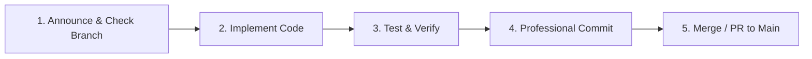

# 🛠️ SENTINEL — Git & Engineering Workflow Guide

This guide establishes the mandatory development, version control, and collaboration standards for the **SENTINEL** repository. All team members and AI coding assistants must strictly adhere to these practices.

---

## 1. 🌿 Branching Strategy: "Never Work on Main"

The `main` branch represents the stable, deployable state of the project. **Direct commits or pushes to `main` are strictly forbidden** during feature development and refactoring.

### 1.1 Branch Types & Naming Conventions

All branches must follow lowercase, hyphen-separated naming prefixed by the work category:

| Prefix | Usage | Example |
|---|---|---|
| `feature/` | New model, script, backend endpoint, or UI component | `feature/weapon-yolo-unification` <br> `feature/fastapi-websocket-feed` <br> `feature/canvas-overlay-ui` |
| `fix/` | Bug fixes or resolving pipeline edge cases | `fix/buffer-iou-calculation` <br> `fix/opencv-stream-disconnect` |
| `docs/` | Documentation, guides, or proposal updates | `docs/proposal-sync-fr` <br> `docs/update-wbs-milestones` |
| `refactor/` | Code structure improvements without functional change | `refactor/extract-pose-module` <br> `refactor/sqlite-orm-models` |
| `test/` | Adding benchmarks, synthetic test feeds, or unit tests | `test/fps-benchmark-suite` <br> `test/lstm-sliding-window-tests` |

---

## 2. 🤖 AI Agent Operational Protocol

Whenever an AI Agent (Cursor, Claude, Copilot, Antigravity, Roo Code) is tasked with a new feature, bug fix, or script, it **must execute the following 5-step lifecycle**:



### Mandatory Agent Steps:
1. **Announce & Verify Branch**:
   * Inspect current branch (`git branch --show-current`).
   * If on `main`, immediately create and switch to a dedicated branch:
     ```bash
     git checkout -b feature/<feature-name>
     ```
   * Explicitly notify the user: *"Creating and switching to branch `feature/...` so `main` remains untouched."*
2. **Implement in Alignment with `PROJECT_CONTEXT.md`**:
   * Adhere strictly to the finalized architecture (YOLOv8s, YOLOv8m-Pose + 2-layer LSTM, Temporal Buffer, FastAPI, React + Canvas).
   * Do not introduce out-of-scope technologies (Face Recognition, 3D-CNNs, TailwindCSS).
3. **Local Testing & Sanity Verification**:
   * Run standalone scripts in `scripts/inference/` or unit tests before declaring completion.
   * Verify frame rates, tensor dimensions, and syntax without syntax or runtime crashes.
4. **Human-Grade Conventional Commit**:
   * Stage only intended files (`git add <files>`).
   * Write an industry-standard Conventional Commit (see Section 3 below).
5. **Merge Back into `Main`**:
   * Once verified, switch back to `main` and merge cleanly:
     ```bash
     git checkout main
     git merge --no-ff feature/<feature-name>
     git push origin main
     ```

---

## 3. ✍️ Professional Commit Message Guidelines (Zero AI Fluff)

Commit messages must look like they were written by an experienced software engineer. **Generic, wordy, or robotic AI messages are strictly forbidden.**

### 3.1 The Conventional Commits Standard
Format:
```
<type>(<scope>): <imperative summary in lowercase, max 72 chars>

[optional body: bullet points explaining what & why, natural technical tone]
```

### 3.2 Bad vs Good Commit Message Matrix

| Bad (AI-Generated Fluff / Unprofessional) | Good (Senior Developer / Conventional Commit) |
|---|---|
| ❌ *"I have updated the code according to the user instructions and added some features to the backend"* | ✅ `feat(backend): implement WebSocket live stream endpoint` |
| ❌ *"Fixed bug where bounding box was disappearing in canvas"* | ✅ `fix(canvas): prevent overlay clearing during frame transition` |
| ❌ *"Updated files as requested by user"* | ✅ `docs(context): sync functional requirements FR-01 to FR-10 with proposal` |
| ❌ *"Modified data preparation scripts for YOLO and LSTM models"* | ✅ `feat(data): add negative background sample generator for weapon dataset` |
| ❌ *"Refactored entire codebase for optimal performance and cleaner architecture"* | ✅ `refactor(pipeline): decouple pose extraction from LSTM temporal window` |

### 3.3 Commit Rules Checklist:
* [x] Use imperative mood: `add`, `fix`, `update`, `implement` (NOT `added`, `fixed`, `updating`).
* [x] Scope in parentheses indicates the component: `(backend)`, `(pipeline)`, `(data)`, `(models)`, `(ui)`, `(docs)`.
* [x] Do not put a period `.` at the end of the subject line.
* [x] Keep subject line under 72 characters.
* [x] If providing a body, explain **why** the change was made and **what** it accomplishes technically.

---

## 4. 🛡️ Defensive Engineering & Integration Standards

To ensure modules developed by different members integrate without conflicts, observe these coding rules:

### 4.1 Path Portability (No Hardcoded Absolute Paths)
* ❌ **Never** write: `cv2.imread("C:/Users/Muddassir/OneDrive/Desktop/FYP/DataSets/...")`
* ✅ **Always** use `pathlib.Path`:
  ```python
  from pathlib import Path
  BASE_DIR = Path(__file__).resolve().parent.parent.parent
  DATA_DIR = BASE_DIR / "DataSets" / "curated"
  ```

### 4.2 Non-Blocking Asynchronous Video Loop
* FastAPI handles WebSocket frame streaming asynchronously.
* Never run heavy synchronous blocking calls directly inside `async def` route handlers without dispatching them to an executor or dedicated worker thread:
  ```python
  import asyncio
  loop = asyncio.get_event_loop()
  # Run heavy model inference in worker thread pool
  detections = await loop.run_in_executor(executor, model.predict, frame)
  ```

### 4.3 Fallback Handling & Graceful Degradation
* Device Selection: Detect CUDA availability dynamically:
  ```python
  import torch
  device = "cuda" if torch.cuda.is_available() else "cpu"
  ```
* Video Stream Disconnect: If CCTV/RTSP camera drops, OpenCV capture loop must attempt automated reconnection with exponential backoff rather than crashing the server.

### 4.4 Secret & Credential Isolation
* Never commit SMTP passwords or API tokens into Git.
* Store credentials in `.env` and load them using `pydantic-settings` or `python-dotenv`.
